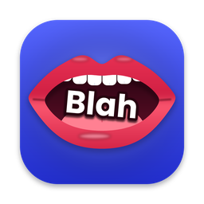

<p align="center"></p>

<h1 align="center">Blah</h1>

<p align="center">
  <b>Free, private voice dictation for Mac.</b><br>
  Hold a key, talk, let go. Your words appear wherever your cursor is.
</p>

---

## Features

- **Works in every app.** Mail, Slack, Notes, your browser, your code editor: anywhere you can type.
- **Private.** Speech becomes text on your Mac with [Whisper](https://github.com/openai/whisper). Your voice is never uploaded.
- **Free.** No account and no subscription.
- **Push-to-talk or hands-free.** Hold the shortcut while you talk, or tap it once to start and again to finish.
- **Fast.** About 2 seconds from letting go to text on a MacBook Air, with three speed and accuracy levels to choose from.
- **Shortcuts.** Say "my email" or "client reply" and Blah types the full text you saved.
- **Dictionary.** Teach Blah names and words so they're always spelled your way.
- **Cleanup (optional).** Removes "um"s, fixes punctuation, and applies corrections like "at 3, no wait, 4". It runs on your Mac with [Ollama](https://ollama.com), or with Claude using your own API key.
- **History.** Search and copy everything you've dictated, and delete one entry or all of it. It's stored only on your Mac.
- **Stays out of the way.** A small mouth icon in the menu bar opens while it listens, and a little pill shows a live waveform.
- **Any microphone.** Pick your mic. If one goes silent, for example AirPods that disconnected, Blah switches to your Mac's built-in mic.
- **Many languages.** Detects your language automatically, or you can set one.

## Requirements

- macOS 12 or newer. Apple Silicon (M1 or later) is recommended.
- Apple's free developer tools. If you don't have them, run `xcode-select --install`.
- Python 3.9 or newer. It comes with the developer tools.
- About 1 GB of free space for the speech model.

## Install

```bash
git clone https://github.com/lucaspennalp-max/blah-mac.git
cd blah-mac
./install.sh
```

Blah opens when the installer finishes. From then on, open it from Spotlight or your Applications folder.

The first dictation downloads the speech model, which takes a minute or two.

## Set up (once)

Blah's window shows a **Finish setting up** list. Click **Allow** for each item and switch Blah on in the System Settings page that opens:

| Permission | Why Blah needs it |
|---|---|
| **Microphone** | To hear you while you hold the shortcut |
| **Input Monitoring** | To notice the shortcut while you're in other apps. Blah never records what you type |
| **Accessibility** | To paste the text where your cursor is |

Then click **Restart Blah** in Settings.

> Using **Fn** as your shortcut? Set *System Settings › Keyboard › Press 🌐 key to* **Do Nothing**, so macOS doesn't open the emoji picker.

## Use

| Do this | What happens |
|---|---|
| Hold **Right Option**, talk, let go | Your words are typed where your cursor is |
| Tap **Right Option** once | Hands-free. Tap again when you're done |
| Press **Esc** while listening | Cancel |

Everything else is in Blah's window:

- **Settings:** shortcut key, speed, microphone, language, cleanup, sounds, open at login
- **Shortcuts:** phrases and the text Blah types for each
- **Dictionary:** names and words Blah should spell your way

### Optional: cleanup on your Mac (free, offline)

1. Install [Ollama](https://ollama.com).
2. Run `ollama pull hermes3:8b`. Use `hermes3:3b` if your Mac has 8 GB of memory.
3. In Blah, choose **Settings › Cleanup › On this Mac**.

### Optional: cleanup with Claude

Paste an [Anthropic API key](https://console.anthropic.com) in **Settings › Cleanup**. Only the text of your dictation is sent, never the audio.

## Privacy and security

| What | Where it goes |
|---|---|
| **Your voice** | Nowhere. It's turned into text on your Mac and never saved |
| **Your text** | Stays on your Mac, unless you turn on **Claude** cleanup, which sends the text to Anthropic |
| **Settings, API key, history** | `~/.blah/`, readable only by your user account |
| **Internet** | Downloading the speech model from Hugging Face, plus Claude cleanup if you turn it on. Nothing else |

How Blah keeps things safe:

- **Never reads your typing.** The keyboard listener is listen-only and only reacts to your shortcut key.
- **No telemetry**, no analytics and no accounts.
- **Window locked to its own page.** It can't be made to load web pages, and only that page can talk to the app.
- **Cleanup can't add text.** If a cleanup result looks like more than a tidy-up of what you said, Blah pastes your original words instead.
- **Your clipboard is restored** after pasting. Blah marks its own paste so clipboard managers skip it.
- **Code you can read.** All of Blah is about 2,700 lines of Python, HTML and C in this repository. Its installed copy is read-only.

Dependencies come from PyPI and the speech model from Hugging Face, so a run of `./install.sh` uses their current versions. Like any app you install yourself, Blah runs with your user account's rights: software already running as you could modify it, so only install from a copy you trust.

## Troubleshooting

| Problem | Fix |
|---|---|
| Works only inside Blah's window | Allow **Input Monitoring**, then **Restart Blah** |
| Text lands on the clipboard instead of being typed | Allow **Accessibility** |
| "Blah can't hear the microphone" | Pick your mic in **Settings › Microphone**, or allow **Microphone** in System Settings |
| Too slow | **Settings › Speed › Fastest** |
| Anything else | Check `~/.blah/blah.log` and [open an issue](../../issues) |

## Update and uninstall

```bash
git pull && ./install.sh       # update; your settings and history are kept
./uninstall.sh                 # remove Blah
./uninstall.sh --everything    # also remove your settings and history
```

## Contributing

**Branches, forks and pull requests are more than welcome.** Fixes, new features, translations, icons and ideas are all appreciated.

1. Fork the repo and create a branch: `git checkout -b my-idea`
2. Make your change. The code is plain Python and one HTML file, with no build step:
   - `blah/app.py`: menu bar, shortcut, microphone, pasting
   - `blah/core.py`: settings, speech-to-text, cleanup, shortcuts
   - `blah/ui/index.html`: the Blah window
   - `blah/pill.py`: the floating waveform
3. Run `./install.sh` to try it.
4. Open a pull request describing what you changed and why.

Found a bug or have an idea? [Open an issue](../../issues).

## License

[MIT](LICENSE). Free to use, change and share.
